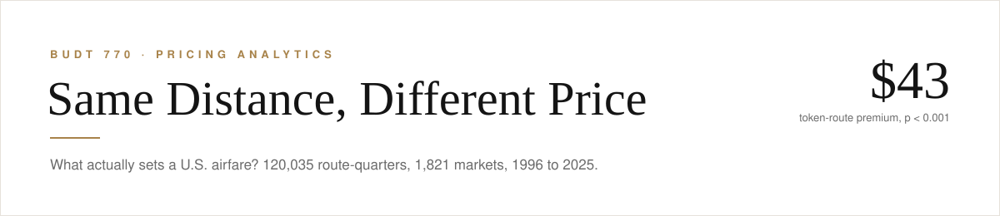
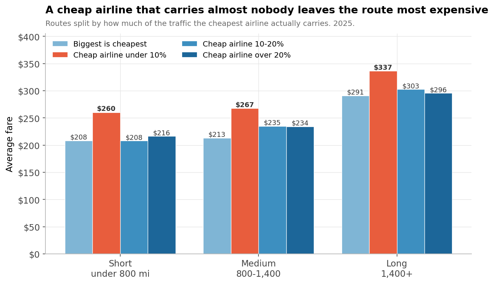
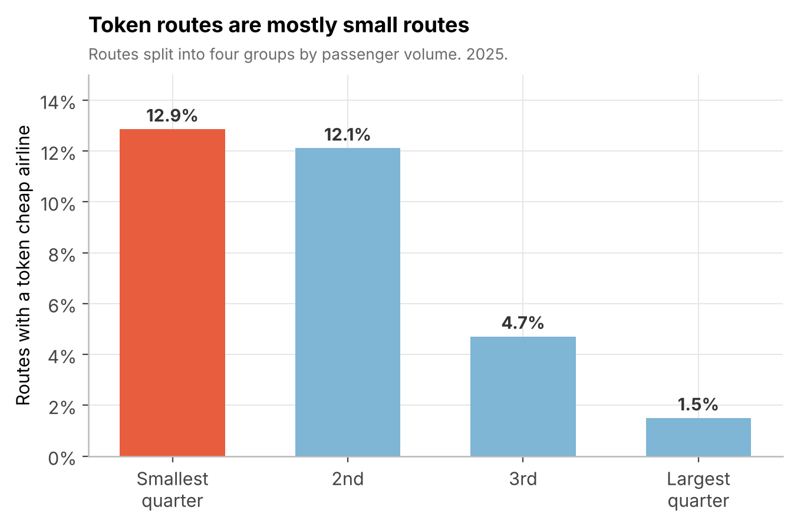

Take every U.S. route between 900 and 1,100 miles in 2025. The cheapest average fare was $86. The most expensive was $377. Same distance, four times the price. We wanted to know why.

**Data:** BTS Consumer Airfare Report, Table 1 (top 1,000 city-pair markets, 1996 Q1 to 2025 Q4). 120,035 rows, 1,821 markets.
**Course:** BUDT 770, University of Maryland Smith School, Fall 2026. Team of 5.

---

## What we found

The numbers below are for 2025 (4,000 route-quarters).

| Hypothesis | What we found | Variance explained |
|---|---|---|
| Longer routes cost more | True, but it only explains a third of the variation (r = 0.587) | 34.5% |
| One airline dominating the route raises fares | About 10% more, but it adds little to the model | +2.6 pts |
| A low-cost airline on the route lowers fares | Only if it actually carries passengers | +3.6 pts |
| **All three** | | **40.8%** |

### The main finding: the discount nobody gets



When a cheaper airline is on a route but carries **fewer than 1 in 10 passengers**, that route ends up the most expensive kind. Having a cheap airline that nobody flies is worse than having none.

- **$43 more** per ticket than comparable routes (95% CI $34 to $51, p < 0.001, Cohen's d = 0.87)
- True in every distance band and every year since 1996
- On these routes the cheap airline advertises about 42% off, but carries under 5% of passengers

### Where this happens

 

- Mostly on small routes: 12.9% of the smallest routes have this pattern vs. 1.5% of the largest (chi-square 130.0, p < 0.001)
- Following the same 790 routes from 1996-2000 to 2021-2025, the ones that **lost** their cheap airline saw fares rise **21% more than the national trend**

---

## Fixing the coordinates

The BTS file comes with latitude and longitude columns, but they were unusable:

1. 26 different cities shared identical coordinates
2. No coordinates at all after 2021
3. 11 of 178 cities never had coordinates
4. 6 geocode columns were completely blank

I dropped all 10 geocode columns and rebuilt them from the **BTS Master Coordinate table**, matching on `CityMarketID` instead of city names. Where a market has several airports (New York has 15), I averaged them to one point. The new coordinates had no duplicates and all fell inside the lower 48. Building them a second way, without the filter, moved 110 markets by at most 8 km, so the choice did not matter.

---

## My role

- Rebuilt and checked the coordinates for all 178 city markets
- Distance analysis: the scatter plot, the distance-band box plot, and the dominant vs. competitive comparison
- The main chart and the $43 gap test (confidence interval, p-value, effect size)
- The route-size analysis and the 30-year tracking of the same routes
- Reran the three-factor model on 2025 data

---

## Repository

```
notebooks/
  01_data_prep_and_geocode_rebuild.ipynb   geocode validation, coordinate rebuild, type cleaning
  02_analysis_and_charts.ipynb             the tests and all 9 charts in figures/
data/
  airfare_enriched.csv                     cleaned data with rebuilt coordinates
figures/                                   exported charts
```

**Run it:** `pip install -r requirements.txt`, then run `notebooks/02_analysis_and_charts.ipynb`. It reads `data/airfare_enriched.csv` and rebuilds every chart in `figures/`.
Notebook 01 was written in Google Colab and reads the raw BTS downloads, so its file paths point to Google Drive.

**Sources:** [BTS Consumer Airfare Report](https://data.transportation.gov/) · [BTS Master Coordinate table](https://www.transtats.bts.gov/)

**Tools:** Python (pandas, NumPy, SciPy, matplotlib), Google Colab
