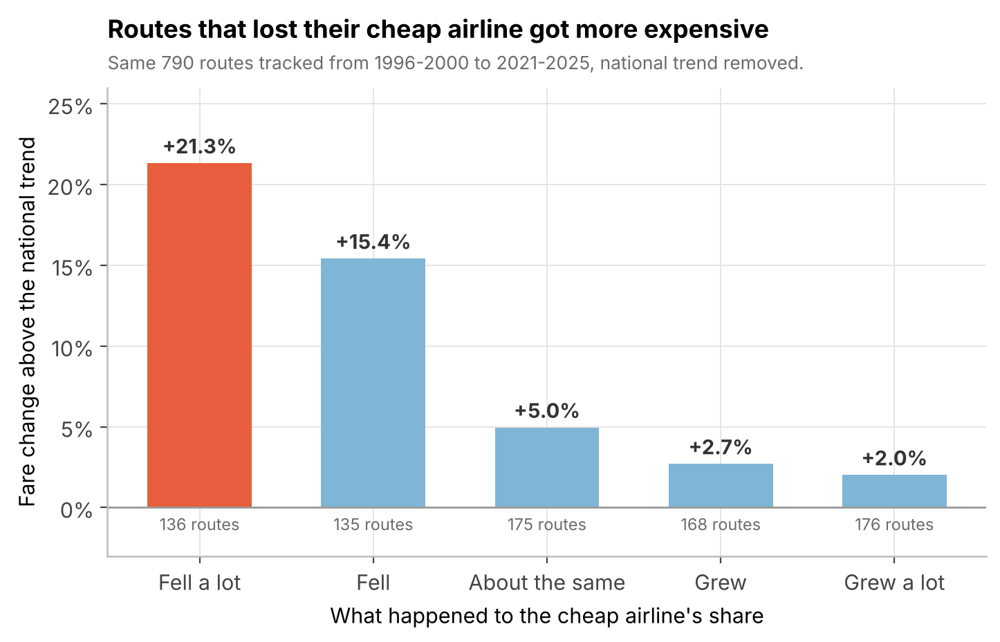

In 2025, 636 quarterly route fares fell between 900 and 1,100 miles. The cheapest was $86. The most expensive was $377. Same distance, 4x the price. This project asks why.

**Data:** BTS Consumer Airfare Report, Table 1 (top 1,000 city-pair markets, 1996 Q1 to 2025 Q4). 120,035 rows, 1,821 markets.
**Team:** 5 people, BUDT 770, University of Maryland Smith School, Fall 2026.

---

## Findings

Model results use 2025 routes (4,000 route-quarters).

| Hypothesis | What we found | Variance explained |
|---|---|---|
| H1. Distance sets the fare | Only about a third of it (r = 0.587) | 34.5% |
| H2. Competition explains the rest | A dominant airline charges about 10% more. Barely moves it | +2.6 pts |
| H3. Cheap airlines make routes cheaper | Only if the cheap airline actually carries passengers | +3.6 pts |
| **All three** | | **40.8%** |

### The main result: the "phantom discount"


When a cheaper airline flies a route but carries **fewer than 1 in 10 passengers**, that route is the most expensive of all. It is worse than having no cheap option at all.

- **$43 higher** fare on comparable routes (95% CI $34 to $51, p < 0.001, Cohen's d = 0.87)
- Holds in every distance band, and every year since 1996
- Token routes advertise about 42% off, but the cheap airline carries under 5% of passengers

### Where token routes show up

 

- Smallest routes are 12.9% token vs. 1.5% for the largest (chi-square 130.0, p < 0.001)
- Tracking the same 790 routes from 1996-2000 to 2021-2025: routes that **lost** their cheap airline rose **21% above the national trend**

---

## Data preparation: rebuilding the coordinates

The original geocode columns could not be trusted:

1. 26 different cities shared identical coordinates
2. No coordinates at all after 2021
3. 11 of 178 cities never had coordinates
4. 6 geocode columns were completely blank

I dropped all 10 geocode columns and rebuilt them from the **BTS Master Coordinate table**, joining on `CityMarketID` instead of city names. Markets served by several airports (New York has 15) were averaged to one point. The rebuilt set passed every check: no duplicate points, all inside the contiguous U.S. A sensitivity check against an unfiltered version moved 110 markets by at most 8 km.

---

## My role

- Rebuilt and validated the geocodes for all 178 city markets
- Built the H1 and H2 analysis: distance scatter, distance-band box plot, dominant vs. competitive comparison
- Built the main H3 chart and ran the $43 gap test (CI, p-value, effect size)
- Built the token-route size analysis and the 30-year route tracking
- Reran the explanatory-power model on 2025 data

---

## Repository

```
notebooks/
  01_data_prep_and_geocode_rebuild.ipynb   geocode validation, coordinate rebuild, type cleaning
  02_analysis_and_charts.ipynb             hypothesis tests and all 8 charts in figures/
data/
  airfare_enriched.csv                     cleaned data with rebuilt coordinates
figures/                                   exported charts
```

**Run it:** `pip install -r requirements.txt`, then run `notebooks/02_analysis_and_charts.ipynb`. It reads `data/airfare_enriched.csv` and rebuilds every chart in `figures/`.
Notebook 01 was written in Google Colab and reads the raw BTS downloads, so its file paths point to Google Drive.

**Sources:** [BTS Consumer Airfare Report](https://data.transportation.gov/) · [BTS Master Coordinate table](https://www.transtats.bts.gov/)

**Tools:** Python (pandas, NumPy, SciPy, matplotlib), Google Colab
